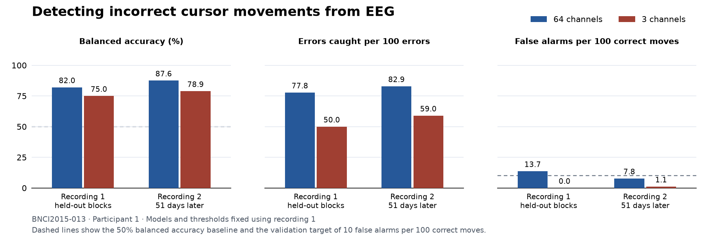

# Can three EEG channels tell when a computer makes a mistake?

Imagine an AI editor moves a button to the wrong place. Before you explain what went wrong, you’ve already seen it. Could a practical EEG setup pick up a signal from that moment?

My [Replicate project](https://github.com/Advik-Singhal/Replicate-Project) compared average brain responses to faces and objects. For my TKS Iterate, I wanted to move from reading averages to testing individual responses. I asked how much performance an EEG classifier would lose if I reduced its inputs from 64 channels to three, then tested it on a later recording.

## From looking at images to watching mistakes

I used public EEG recordings from a study by Ricardo Chavarriaga and José del R. Millán. Participants watched a cursor move towards or away from a target. That gave me a clear event to align the EEG to, as well as a label for whether each move was correct or incorrect. I started with one participant whose two recordings were 51 days apart. [Dataset protocol](https://lampx.tugraz.at/~bci/database/013-2015/description.pdf)

I measured the average voltage in short time bins during the first 600 milliseconds after each movement. I trained the same type of classifier twice, once with all 64 channels and once with Fz, FCz, and Cz. Both learned from the same first-day trials. I also used separate blocks from that day to decide when each classifier should flag a mistake, then tested the locked models on the later recording.

## What changed with three channels?

The full model caught **97 of 117 mistakes**. The three-channel version caught **69**. It also raised only **5 false alarms**, compared with **34** for the full model, across 438 correct movements. Balanced accuracy, which gives the two types of movement equal weight, dropped from **87.6% to 78.9%**. An always-correct rule scored 50%.

At the threshold I tested, the three-channel version would interrupt less often and miss more of the moments I’d want it to catch. I also compared the models across thresholds. The full model ranked errors more reliably overall and when I checked left and right cursor moves separately. These measurements come from one person, using three signals selected from a laboratory recording.

I’d next repeat the comparison across the other participants. From there, I’d design a separate test for what I actually want to build. If an AI applies the wrong change to a website, can the signals help it decide when to ask what it missed?

[Run the notebook](https://colab.research.google.com/github/Advik-Singhal/Iterate-Project/blob/main/iterate.ipynb) · [Read the findings](FINDINGS.md)
