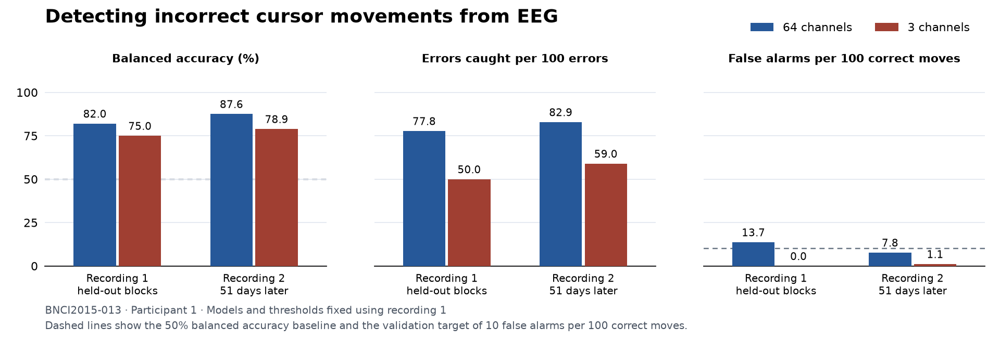

# Can three EEG channels detect cursor errors across days?

A project comparing 64-channel and three-channel EEG classifiers to see how well they detect responses to cursor errors on a later recording day. I trained both versions on the first recording and tested them again on a recording made 51 days later.

This builds on my [Replicate](https://github.com/Advik-Singhal/Replicate-Project), where I averaged EEG responses to faces and objects. Here, the classifier makes a prediction for each cursor movement. The goal is to learn whether a simpler setup could give a future AI design tool a useful signal when a user notices a mistake.

## Results on the later recording

| Input | Balanced accuracy | Errors caught | False alarms per 100 correct moves |
| --- | ---: | ---: | ---: |
| 64 EEG channels | 87.6% | 97 of 117 | 7.8 |
| Fz, FCz and Cz | 78.9% | 69 of 117 | 1.1 |
| Always predict correct | 50.0% | 0 of 117 | 0.0 |

Three channels cost **8.7 percentage points of balanced accuracy** at the thresholds chosen on the first recording. The reduced model missed 28 more errors and produced 29 fewer false alarms on the same 555 trials. [Full findings and limitations](FINDINGS.md)

The 64-channel model also ranked errors above correct moves more reliably across decision thresholds. On the later recording, ROC AUC was **0.940** for 64 channels and **0.892** for three. [View the ROC figure](recording-2-roc.svg)

## How it works

The analysis uses participant 1 from **BNCI2015-013**. I averaged voltages in 50 ms bins over the first 600 ms after each cursor movement. Both models used the same preprocessing, time bins, trials, and shrinkage linear discriminant analysis. I fixed the three frontocentral channel names before testing. I used six blocks from the first recording to fit the models, two to choose thresholds, and two to measure within-day performance. The later recording was reserved for final evaluation. [Original dataset and protocol](https://lampx.tugraz.at/~bci/database/013-2015/description.pdf)

## Run the notebook

1. [Open in Google Colab](https://colab.research.google.com/github/Advik-Singhal/Iterate-Project/blob/main/iterate.ipynb) and choose **Runtime → Run all**. The first data load downloads about **506 MiB** from the public dataset.
2. Run locally with Python 3.12 by installing `requirements.txt`, then open `iterate.ipynb` in Jupyter or VS Code and run all cells.
3. [Read the executed notebook](iterate_executed.ipynb) to see the outputs and file checksums without a download. The notebook was executed in local Jupyter.

The notebook writes [results.json](results.json) and the comparison and ROC plots. It validates the source files with SHA-256 checksums and caches them in `data/` by default. Set `ITERATE_DATA_DIR` to reuse an existing download.

[Read the project article](ARTICLE.md) · [Walkthrough script](WALKTHROUGH.md)

## Source

Chavarriaga, R., & Millán, J. D. R. (2010). *Learning from EEG error-related potentials in noninvasive brain-computer interfaces*. IEEE Transactions on Neural Systems and Rehabilitation Engineering, 18(4), 381–388. [Paper](https://doi.org/10.1109/TNSRE.2010.2053387) · [Recording format and event labels](https://lampx.tugraz.at/~bci/database/013-2015/description.pdf)
